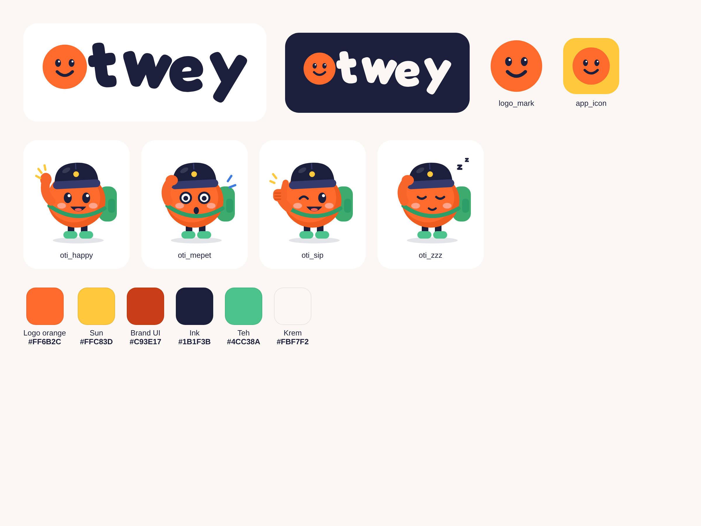

# OTWEY

Perencana perjalanan sehari dengan Whoosh, dua arah Jakarta ⇄ Bandung. Hackathon internal KCIC.

*Make every stop count.*



## Dokumen

| File | Isi |
| --- | --- |
| `docs/PRD.md` | Kebutuhan produk, aturan planner, skenario demo, tahapan kerja |
| `docs/RULES.md` | Tech stack, arsitektur, database, desain, copy, git |
| `docs/DESIGN_SYSTEM.md` | Token warna, tipografi, komponen, gaya bahasa |
| `docs/BRAND.md` | Logo, maskot Oti, ikon aplikasi, font, aturan pakai aset |
| `supabase/migrations/` | Skema database |

## Kebutuhan

* Flutter **3.50** (Dart 3.14). Cek dengan `flutter --version`.
* Supabase project (opsional untuk mencoba UI).

## Setup pertama kali

Folder ini berisi kode, aset, dan dokumen, belum berisi folder platform. Buat dengan:

```
flutter create . --project-name otwey --org com.kcic.hackathon --platforms android,ios
flutter pub get
flutter analyze
flutter test
```

`flutter create .` tidak menimpa file yang sudah ada, jadi `lib/`, `assets/`, `pubspec.yaml`, dan `test/` tetap aman.
Kalau ada konflik versi package, jalankan `flutter pub upgrade --major-versions`.

Ikon aplikasi (opsional): ikuti bagian "Ikon aplikasi" di `docs/BRAND.md`.

## Menjalankan

1. Salin `.env.example` menjadi `.env`, isi URL dan anon key Supabase.
2. Jalankan:

```
flutter run --dart-define-from-file=.env
```

Tanpa `.env`, aplikasi tetap jalan (Supabase tidak diinisialisasi) untuk mencoba alur UI.

## Database

```
supabase link --project-ref <ref>
supabase db push
```

## Struktur

```
assets/
  brand/        logo, ikon, Oti (SVG/PNG)
  fonts/        Fredoka, Plus Jakarta Sans, JetBrains Mono (OFL)
lib/
  core/         assets, config, theme, router, copy, utils, widgets
  features/
    trip_setup/   arah, waktu, tujuan kamu, vibes
    planner/      jadwal, pemilihan kereta, penyusun itinerary, hasil
    places/       tempat wisata dan kuliner
    saved_trips/  trip tersimpan
supabase/migrations/
docs/
```
