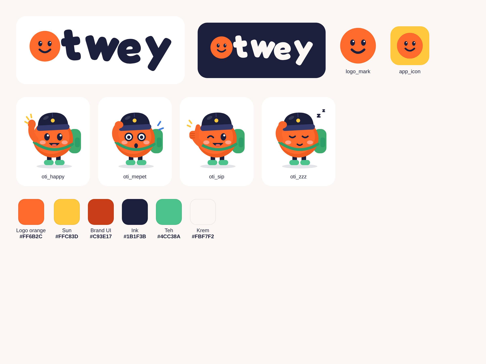

# Brand: OTWEY



| | |
| --- | --- |
| Nama | **OTWEY** (dibaca "ot-wei", dari OTW + way). Di teks selalu huruf kapital: OTWEY |
| Tagline | Make every stop count. |
| Pendamping tagline | Kerjaan beres, main juga sempat, pulang tetap on time. |
| Kepribadian | Modern, playful, explorative, praktis |
| Maskot | Oti |

Sumber desain: canvas brand "OTWEY Logo & Maskot" dan design system "OTWEY". File di bawah adalah hasil ekspor dari sana.

## Isi folder aset

```
assets/
  brand/
    logo.svg                 # logo utama, teks navy, latar transparan
    logo_on_dark.svg         # untuk latar gelap, teks krem
    logo_mark.svg            # huruf o tersenyum saja
    app_icon.svg / .png      # ikon aplikasi 1024 px, latar sun, full bleed
    app_icon_foreground.svg / .png  # foreground adaptive icon Android (transparan)
    oti_happy.svg
    oti_mepet.svg
    oti_sip.svg
    oti_zzz.svg
  fonts/
    Fredoka-SemiBold.ttf, Fredoka-Bold.ttf
    PlusJakartaSans-Regular/Medium/SemiBold/Bold/ExtraBold.ttf
    JetBrainsMono-Medium.ttf, JetBrainsMono-SemiBold.ttf
    OFL-*.txt                # lisensi, wajib ikut
```

Semua SVG sudah aman untuk `flutter_svg`: tanpa `<text>` (huruf sudah jadi path), tanpa CSS, tanpa filter.

Di kode, pakai konstanta dan widget, bukan path manual:

```dart
import 'package:otwey/core/assets/app_assets.dart';
import 'package:otwey/core/widgets/brand.dart';

const OtweyLogo(height: 32);
const OtweyLogo(height: 32, onDark: true);
const Oti(mood: OtiMood.mepet, size: 160);
```

## Logo

Wordmark "otwey" dengan huruf **o tersenyum** dan huruf t, w, e, y yang sedikit miring dan naik turun, seperti melompat. Dasar hurufnya Fredoka Bold, sudah dikonversi jadi path.

Aturan:
* Ruang kosong di sekeliling logo minimal setengah tinggi huruf o.
* Tinggi minimal 24 px di layar. Di bawah itu pakai `logo_mark.svg`.
* Di latar terang pakai `logo.svg`, di latar gelap `logo_on_dark.svg`.
* Jangan diregangkan, diputar, diberi bayangan, atau diganti warnanya.
* Jangan meluruskan huruf yang melompat. Kemiringan itu bagian dari logo.

## Ikon aplikasi

`app_icon.png` (1024 px, latar `sun`, wajah o di tengah) dan `app_icon_foreground.png` untuk adaptive icon Android dengan latar `#FFC83D`.

Cara pasang (opsional, saat setup platform):

```
flutter pub add dev:flutter_launcher_icons
```

Tambahkan ke `pubspec.yaml`:

```yaml
flutter_launcher_icons:
  android: true
  ios: true
  image_path: assets/brand/app_icon.png
  adaptive_icon_background: "#FFC83D"
  adaptive_icon_foreground: assets/brand/app_icon_foreground.png
  remove_alpha_ios: true
```

Lalu `dart run flutter_launcher_icons`.

## Maskot Oti

Makhluk bulat oranye berbentuk huruf o di logo, memakai topi kondektur navy dengan kancing kuning, ransel hijau di punggung, dan sepatu hijau. Rasio gambar 200 x 220.

| Ekspresi | File | Pose | Kapan dipakai | Contoh copy |
| --- | --- | --- | --- | --- |
| `happy` | `oti_happy.svg` | Melambai | Onboarding, loading, hasil rencana berhasil | "OTW!", "Lagi nyusun rute terbaik buat kamu..." |
| `mepet` | `oti_mepet.svg` | Pegang kepala, mata kaget | Status mepet, konflik tujuan Wajib, tidak keburu | "Mepet nih · 25 mnt lagi" |
| `sip` | `oti_sip.svg` | Jempol, berkedip | Rencana tersimpan, status aman | "Sip, aman" |
| `zzz` | `oti_zzz.svg` | Pegang kepala, tidur | Empty state, belum ada trip | "Nanti aja", "Belum ada trip tersimpan" |

Aturan:
* Satu Oti per layar.
* Jangan memakai `mepet` untuk dekorasi. Ekspresi harus sesuai keadaan.
* Jangan mengubah warna Oti atau menambah aksesoris di kode. Ekspresi baru dibuat di canvas desain dulu, lalu diekspor.

## Oti bergerak (sudah ada)

`AnimatedOti` (`lib/core/widgets/animated_oti.dart`) memberi gerak tubuh sederhana tanpa Rive:
`bob` (loading menyusun rute), `breathe` (empty state), `sniff` (loading tempat), `worry` (dialog peringatan).
Semua diam saat "kurangi gerakan" aktif. Ikon OTWEY (55 ikon, line dan fill) ada di `OtwIconView`
dan bergerak sebentar saat dipilih.

## Rencana animasi (setelah MVP)

1. Impor SVG Oti ke **Rive**. Layer sudah terpisah: badan, topi, ransel, kaki, tangan, mata, mulut.
2. Buat state machine dengan input `mood` (happy, mepet, sip, zzz) dan animasi idle (napas pelan, kedip).
3. Pakai package `rive` di Flutter, ganti widget `Oti` tanpa mengubah pemanggilnya.

Untuk tampilan lebih "3D", tambahkan gradasi di badan dan topi. Catatan: `flutter_svg` mendukung gradasi tapi tidak mendukung blur, sedangkan Rive mendukung keduanya.

## Widget home screen (ide lanjutan)

Pakai `home_widget`. Isi widget: ekspresi Oti sesuai status trip hari ini, jam kereta pulang, dan sisa waktu. Contoh: Oti `mepet` dengan "Mepet nih · 25 mnt lagi" saat sudah waktunya jalan ke stasiun.

## Warna brand

| Token | Hex | Pakai untuk |
| --- | --- | --- |
| `logoOrange` | `#FF6B2C` | Logo, Oti, ilustrasi |
| `sun` | `#FFC83D` | Ikon aplikasi, latar ilustrasi |
| `brand` | `#C93E17` | Tombol dan teks bernuansa brand (kontras aman) |
| `ink` | `#1B1F3B` | Teks, huruf logo |
| `accent` (Teh) | `#1F7A55` / `#4CC38A` | Status aman, sepatu dan ransel Oti |
| `surface-100` (Krem) | `#FBF7F2` | Latar |

Token lengkap: `docs/DESIGN_SYSTEM.md` dan `lib/core/theme/app_colors.dart`.

## Lisensi font

Fredoka, Plus Jakarta Sans, dan JetBrains Mono memakai SIL Open Font License 1.1: boleh dibundel dan dipakai komersial, file lisensi `assets/fonts/OFL-*.txt` harus ikut. Font hanya berisi subset latin (cukup untuk bahasa Indonesia).
